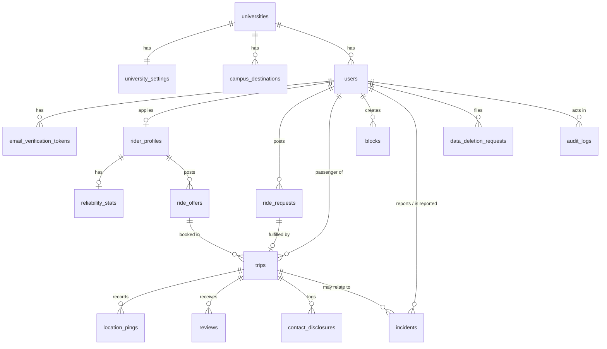

# Varsity Chaka: Phase 3 Database Design

Status: DRAFT v0.1, 11 Nov 2026. Builds on `01-requirements.md` and `02-architecture.md`.

## 1. Design rules

1. MySQL 8, InnoDB, utf8mb4. Migrations are written with Alembic.
2. Every tenant-owned table has `university_id` (NOT NULL, foreign key, indexed). Only `universities` and `users` rows of a super admin have no tenant.
3. Primary keys are `BIGINT UNSIGNED AUTO_INCREMENT` named `id`.
4. Timestamps are stored in UTC (`created_at`, `updated_at`).
5. Enumerated values use MySQL `ENUM` or `VARCHAR` with a check in the service layer. The values are listed below.
6. Latitude and longitude are `DECIMAL(9,6)`.
7. Sensitive files (registration card photo) store only a private path, never the file itself.
8. The database never stores plain passwords. `password_hash` holds the Argon2 hash.
9. Training data for the ETA model is synthetic and lives in `ml/`, not in this database.

## 2. ER diagram

## 3. Tables

### 3.1 Tenancy

**universities** (one row per tenant)

| Column | Type | Notes |
|---|---|---|
| id | BIGINT PK | |
| name | VARCHAR(150) | Full name, e.g. Daffodil International University |
| short_code | VARCHAR(20) UNIQUE | e.g. DIU |
| email_domain | VARCHAR(100) UNIQUE | e.g. diu.edu.bd; used to check registration email |
| logo_path | VARCHAR(255) NULL | Branding |
| primary_color | CHAR(7) NULL | Branding, e.g. #1A73E8 |
| is_active | BOOLEAN | Disable a tenant without deleting it |
| created_at | DATETIME | |

**university_settings** (one row per university; per-tenant policy)

| Column | Type | Notes |
|---|---|---|
| university_id | BIGINT PK, FK | One-to-one with universities |
| fuel_price_per_litre | DECIMAL(8,2) | Admin-updatable |
| max_rate_per_km | DECIMAL(6,2) | Fare ceiling |
| demand_adjustment_enabled | BOOLEAN | Tenant can switch demand effect off |
| demand_cap_percent | TINYINT | Cap on demand adjustment |
| match_max_pickup_m | INT | Hard filter: max pickup distance |
| match_max_detour_m | INT | Hard filter: max rider detour |
| match_time_window_min | INT | Hard filter: allowed departure-time gap |
| weight_pickup, weight_overlap, weight_detour, weight_time, weight_destination, weight_reliability | DECIMAL(4,3) | Matching weights; sum to 1 |
| updated_at | DATETIME | |

**campus_destinations**

| Column | Type | Notes |
|---|---|---|
| id | BIGINT PK | |
| university_id | BIGINT FK, indexed | |
| name | VARCHAR(150) | e.g. DIU Main Gate |
| latitude, longitude | DECIMAL(9,6) | |
| is_active | BOOLEAN | |

### 3.2 Accounts

**users**

| Column | Type | Notes |
|---|---|---|
| id | BIGINT PK | |
| university_id | BIGINT FK NULL, indexed | NULL only for super_admin |
| email | VARCHAR(190) UNIQUE | Must match the tenant's email domain |
| password_hash | VARCHAR(255) | Argon2 |
| full_name | VARCHAR(150) | |
| phone | VARCHAR(20) | Shown only after trip confirmation |
| student_id_no | VARCHAR(50) NULL | Optional cross-check by admin |
| role | ENUM('super_admin','university_admin','student') | |
| email_verified_at | DATETIME NULL | NULL means not verified |
| is_active | BOOLEAN | False when banned or anonymized |
| anonymized_at | DATETIME NULL | Set by data deletion |
| created_at, updated_at | DATETIME | |

Constraints: `UNIQUE (university_id, student_id_no)`.

**email_verification_tokens**

| Column | Type | Notes |
|---|---|---|
| id | BIGINT PK | |
| user_id | BIGINT FK | |
| token_hash | CHAR(64) | Hash of the token, never the raw token |
| expires_at | DATETIME | |
| used_at | DATETIME NULL | |

### 3.3 Rider trust

**rider_profiles** (the rider application and its approval state)

| Column | Type | Notes |
|---|---|---|
| id | BIGINT PK | |
| university_id | BIGINT FK, indexed | |
| user_id | BIGINT FK UNIQUE | One profile per user |
| motorcycle_model | VARCHAR(100) | |
| engine_class | ENUM('cc100','cc125_150','cc150_plus') | Drives the fuel-efficiency default |
| plate_number | VARCHAR(30) | |
| registration_doc_path | VARCHAR(255) | Private upload path |
| license_declared | BOOLEAN | Self-declaration |
| helmet_declared | BOOLEAN | Self-declaration |
| status | ENUM('pending','approved','rejected','suspended','expired') | |
| reviewed_by | BIGINT FK NULL | Admin user |
| reviewed_at | DATETIME NULL | |
| rejection_reason | VARCHAR(255) NULL | |
| approved_at | DATETIME NULL | |
| expires_at | DATETIME NULL | approved_at + 2 years |
| created_at, updated_at | DATETIME | |

Constraints: `UNIQUE (university_id, plate_number)`.

**reliability_stats** (derived summary, updated by the service after each trip and review)

| Column | Type | Notes |
|---|---|---|
| rider_profile_id | BIGINT PK, FK | |
| university_id | BIGINT FK, indexed | |
| completed_count | INT | |
| cancelled_count | INT | |
| rating_sum | INT | Average = rating_sum / rating_count |
| rating_count | INT | |
| on_time_count | INT | |
| updated_at | DATETIME | |

This is derived data kept for fast matching. It can be rebuilt from `trips` and `reviews`.

### 3.4 Rides and trips

**ride_offers**

| Column | Type | Notes |
|---|---|---|
| id | BIGINT PK | |
| university_id | BIGINT FK, indexed | |
| rider_profile_id | BIGINT FK | |
| origin_lat, origin_lng | DECIMAL(9,6) | |
| origin_label | VARCHAR(150) | |
| dest_lat, dest_lng | DECIMAL(9,6) | |
| dest_label | VARCHAR(150) | |
| direction | ENUM('to_campus','from_campus') | |
| departure_time | DATETIME | |
| route_distance_m | INT NULL | From OSRM |
| route_duration_s | INT NULL | From OSRM |
| route_geometry | JSON NULL | Encoded route for overlap calculation |
| status | ENUM('open','booked','closed','cancelled') | |
| created_at | DATETIME | |

Index: `(university_id, status, departure_time)`.

**ride_requests**

| Column | Type | Notes |
|---|---|---|
| id | BIGINT PK | |
| university_id | BIGINT FK, indexed | |
| passenger_id | BIGINT FK | users.id |
| pickup_lat, pickup_lng | DECIMAL(9,6) | |
| pickup_label | VARCHAR(150) | |
| dest_lat, dest_lng | DECIMAL(9,6) | |
| dest_label | VARCHAR(150) | |
| preferred_time | DATETIME | |
| status | ENUM('open','matched','cancelled','expired') | |
| created_at | DATETIME | |

**trips**

| Column | Type | Notes |
|---|---|---|
| id | BIGINT PK | |
| university_id | BIGINT FK, indexed | |
| ride_offer_id | BIGINT FK | |
| ride_request_id | BIGINT FK | |
| rider_profile_id | BIGINT FK | |
| passenger_id | BIGINT FK | |
| status | ENUM('requested','accepted','confirmed','in_progress','completed','cancelled') | State machine from section 6 of the requirements |
| active_offer_id | BIGINT UNIQUE NULL | Equals ride_offer_id while the trip is active, NULL when it ends. The unique index enforces one passenger per motorcycle at database level. |
| match_score | DECIMAL(5,2) NULL | |
| match_explanation | VARCHAR(500) NULL | Generated text |
| suggested_fare_min, suggested_fare_max | DECIMAL(8,2) NULL | Advisory range |
| eta_start, eta_end | DATETIME NULL | Arrival range |
| helmet_confirmed_at | DATETIME NULL | |
| accepted_at, confirmed_at, started_at, completed_at, cancelled_at | DATETIME NULL | |
| cancelled_by | BIGINT FK NULL | |
| rider_confirmed_complete_at | DATETIME NULL | |
| passenger_confirmed_complete_at | DATETIME NULL | |
| disputed | BOOLEAN | |
| created_at, updated_at | DATETIME | |

Index: `(university_id, status)`, `(rider_profile_id, status)`, `(passenger_id, status)`.

**location_pings** (deleted after the trip per the retention rule)

| Column | Type | Notes |
|---|---|---|
| id | BIGINT PK | |
| university_id | BIGINT FK, indexed | |
| trip_id | BIGINT FK | |
| latitude, longitude | DECIMAL(9,6) | |
| recorded_at | DATETIME | |

Index: `(trip_id, recorded_at)`.

**contact_disclosures**

| Column | Type | Notes |
|---|---|---|
| id | BIGINT PK | |
| university_id | BIGINT FK | |
| trip_id | BIGINT FK | |
| viewer_id | BIGINT FK | Who saw the details |
| disclosed_user_id | BIGINT FK | Whose details were shown |
| created_at | DATETIME | |

### 3.5 Feedback and safety

**reviews**

| Column | Type | Notes |
|---|---|---|
| id | BIGINT PK | |
| university_id | BIGINT FK | |
| trip_id | BIGINT FK | |
| reviewer_id | BIGINT FK | |
| reviewee_id | BIGINT FK | |
| rating | TINYINT | 1 to 5 |
| arrived_on_time | BOOLEAN NULL | Feeds on-time performance |
| tags | JSON NULL | |
| comment | VARCHAR(500) NULL | |
| created_at | DATETIME | |

Constraints: `UNIQUE (trip_id, reviewer_id)`, `CHECK (rating BETWEEN 1 AND 5)`.

**blocks**

| Column | Type | Notes |
|---|---|---|
| id | BIGINT PK | |
| university_id | BIGINT FK | |
| blocker_id | BIGINT FK | |
| blocked_id | BIGINT FK | |
| created_at | DATETIME | |

Constraints: `UNIQUE (blocker_id, blocked_id)`.

**incidents** (reports and SOS)

| Column | Type | Notes |
|---|---|---|
| id | BIGINT PK | |
| university_id | BIGINT FK, indexed | |
| reporter_id | BIGINT FK | |
| reported_user_id | BIGINT FK NULL | |
| trip_id | BIGINT FK NULL | |
| category | ENUM('no_helmet','second_passenger','unsafe_riding','harassment','no_show','sos','other') | |
| priority | ENUM('normal','high') | SOS is high |
| description | VARCHAR(1000) NULL | |
| status | ENUM('new','under_review','action_taken','dismissed') | |
| action_taken | ENUM('none','warning','suspension','de_approval','ban') | |
| admin_notes | VARCHAR(1000) NULL | |
| handled_by | BIGINT FK NULL | |
| resolved_at | DATETIME NULL | |
| created_at | DATETIME | |

**data_deletion_requests**

| Column | Type | Notes |
|---|---|---|
| id | BIGINT PK | |
| university_id | BIGINT FK | |
| user_id | BIGINT FK | |
| status | ENUM('requested','completed','rejected') | |
| requested_at | DATETIME | |
| processed_by | BIGINT FK NULL | |
| processed_at | DATETIME NULL | |

**audit_logs**

| Column | Type | Notes |
|---|---|---|
| id | BIGINT PK | |
| university_id | BIGINT FK NULL | NULL for super admin actions |
| actor_id | BIGINT FK | |
| action | VARCHAR(80) | e.g. rider_approved |
| target_type | VARCHAR(50) | |
| target_id | BIGINT NULL | |
| details | JSON NULL | No sensitive content |
| created_at | DATETIME | |

## 4. Tenant isolation rules at database level

- Every table above except `universities` carries `university_id`.
- Foreign keys between tenant tables are checked in the service layer to stay inside one university (for example, a trip's offer and request must share its `university_id`).
- Tenant isolation tests (FR-T3) are written against these tables.

## 5. Mapping to the three core features

| Core feature | Main tables |
|---|---|
| Authentication | users, email_verification_tokens, universities |
| Rider application and approval | rider_profiles, audit_logs |
| Explainable matching | ride_offers, ride_requests, reliability_stats, blocks, university_settings, trips |
| Fare and ETA range | university_settings, trips, ride_offers |

## 6. Migration plan (Alembic)

| Migration | Tables | Needed for |
|---|---|---|
| 001 | universities, university_settings, campus_destinations, users, email_verification_tokens | Authentication module |
| 002 | rider_profiles, reliability_stats, audit_logs | Rider application and approval |
| 003 | ride_offers, ride_requests, trips, blocks | Matching and trips |
| 004 | location_pings, contact_disclosures, reviews, incidents, data_deletion_requests | Live location and safety |

Each migration is committed separately, so the history shows the database growing with the project.

## 7. Open questions

1. Is a plain `ENUM` acceptable, or do you prefer lookup tables? ENUM is simpler for 30 days.
2. Should the second demo tenant be seeded with sample users and rides for the demo?
3. Is the engine class list (100 cc, 125-150 cc, 150 cc and above) enough for the fuel-efficiency default?
